# Microsoft Cloud Product Icons

A curated collection of **official SVG and PNG icons** for Microsoft Cloud products.
One icon per product — clean, consistent, ready to use.

**👉 [Browse the icon collection live](https://damobird365.github.io/microsoft-cloud-icons/)**

**136 product icons** across **9 categories**

## Quick Reference

| Category | Icons | Products |
|----------|-------|----------|
| Microsoft 365 | 26 | Access, Bookings, Calendar, Clipchamp, Delve, Excel, Forms, Lists, Loop, Microsoft 365, OneDrive, OneNote, Outlook, Places, Planner, PowerPoint, Project, Publisher, SharePoint, Stream, Sway, Teams, To Do, Visio, Whiteboard, Word |
| Power Platform | 12 | Agent 365, Agent Builder, AI Builder, Connectors, Copilot Studio, Dataverse, Power Apps, Power Automate, Power BI, Power Fx, Power Pages, Power Platform |
| Dynamics 365 | 16 | Business Central, Commerce, Contact Center, Customer Insights, Customer Service, Customer Voice, Dynamics 365, Field Service, Finance, Finance & Operations, Human Resources, Intelligent Order Management, Project Operations, Sales, Sales Insights, Supply Chain Management |
| Copilot | 2 | Microsoft 365 Copilot, Microsoft Copilot |
| Entra | 4 | Entra ID, Entra ID Governance, Entra Verified ID, Microsoft Entra |
| Security | 2 | Defender, Purview |
| Viva | 9 | Viva Amplify, Viva Connections, Viva Engage, Viva Glint, Viva Home, Viva Insights, Viva Learning, Viva Pulse, Viva Suite |
| Fabric | 58 | Microsoft Fabric, Action, Apps, Cohort, Copy Job, Custom Streaming Connector, Dashboard, Data Agent, Data Factory, Data Quality, Warehouse, Dataflow, Dataflow Gen2, Datamart, Environment, Eventhouse, Eventstream, ML Experiment, Exploration, External Dataflow, External Datamart, External Semantic Model, Fabric Apps, Feature Store, Healthcare Data Solutions, KQL Database, KQL Queryset, KQL Script, Lakehouse, Links, Metric Set, Mirrored Catalog, Mirrored Database, Mirrored Storage, Mobile Report, ML Model, Notebook, Ontology, Operations Agent, Paginated Report, Pipeline, Planning, RDL Report, Real-Time Dashboard, Report, Retail Data Solutions, Runtime Lineage, Schema Model, Scorecard, Semantic Model, Shared Semantic Model, Spark Job Definition, SQL Database, Streaming Dataflow, Streaming Semantic Model, Sustainability Data Solutions, User Data Functions, Variable Library |
| Other | 7 | Admin Center, Bing, Designer, Family Safety, Microsoft Edge, Microsoft Foundry, Office |

## All Icons

### Microsoft 365

| Icon | Product | File |
|------|---------|------|
|  | **Access** | `icons/microsoft-365/access.svg` |
|  | **Bookings** | `icons/microsoft-365/bookings.svg` |
|  | **Calendar** | `icons/microsoft-365/calendar.svg` |
|  | **Clipchamp** | `icons/microsoft-365/clipchamp.svg` |
|  | **Delve** | `icons/microsoft-365/delve.svg` |
|  | **Excel** | `icons/microsoft-365/excel.svg` |
|  | **Forms** | `icons/microsoft-365/forms.svg` |
|  | **Lists** | `icons/microsoft-365/lists.svg` |
|  | **Loop** | `icons/microsoft-365/loop.svg` |
|  | **Microsoft 365** | `icons/microsoft-365/microsoft-365.svg` |
|  | **OneDrive** | `icons/microsoft-365/onedrive.svg` |
|  | **OneNote** | `icons/microsoft-365/onenote.svg` |
|  | **Outlook** | `icons/microsoft-365/outlook.svg` |
|  | **Places** | `icons/microsoft-365/places.svg` |
|  | **Planner** | `icons/microsoft-365/planner.svg` |
|  | **PowerPoint** | `icons/microsoft-365/powerpoint.svg` |
|  | **Project** | `icons/microsoft-365/project.svg` |
|  | **Publisher** | `icons/microsoft-365/publisher.svg` |
|  | **SharePoint** | `icons/microsoft-365/sharepoint.svg` |
|  | **Stream** | `icons/microsoft-365/stream.svg` |
|  | **Sway** | `icons/microsoft-365/sway.svg` |
|  | **Teams** | `icons/microsoft-365/teams.svg` |
|  | **To Do** | `icons/microsoft-365/todo.svg` |
|  | **Visio** | `icons/microsoft-365/visio.svg` |
|  | **Whiteboard** | `icons/microsoft-365/whiteboard.svg` |
|  | **Word** | `icons/microsoft-365/word.svg` |

### Power Platform

| Icon | Product | File |
|------|---------|------|
|  | **Agent 365** | `icons/power-platform/agent-365.svg` |
|  | **Agent Builder** | `icons/power-platform/agent-builder.svg` |
|  | **AI Builder** | `icons/power-platform/ai-builder.svg` |
|  | **Connectors** | `icons/power-platform/connectors.svg` |
|  | **Copilot Studio** | `icons/power-platform/copilot-studio.svg` |
|  | **Dataverse** | `icons/power-platform/dataverse.svg` |
|  | **Power Apps** | `icons/power-platform/power-apps.svg` |
|  | **Power Automate** | `icons/power-platform/power-automate.svg` |
|  | **Power BI** | `icons/power-platform/power-bi.svg` |
|  | **Power Fx** | `icons/power-platform/power-fx.svg` |
|  | **Power Pages** | `icons/power-platform/power-pages.svg` |
|  | **Power Platform** | `icons/power-platform/power-platform.svg` |

### Dynamics 365

| Icon | Product | File |
|------|---------|------|
|  | **Business Central** | `icons/dynamics-365/business-central.svg` |
|  | **Commerce** | `icons/dynamics-365/commerce.svg` |
|  | **Contact Center** | `icons/dynamics-365/contact-center.svg` |
|  | **Customer Insights** | `icons/dynamics-365/customer-insights.svg` |
|  | **Customer Service** | `icons/dynamics-365/customer-service.svg` |
|  | **Customer Voice** | `icons/dynamics-365/customer-voice.svg` |
|  | **Dynamics 365** | `icons/dynamics-365/dynamics-365.svg` |
|  | **Field Service** | `icons/dynamics-365/field-service.svg` |
|  | **Finance** | `icons/dynamics-365/finance.svg` |
|  | **Finance & Operations** | `icons/dynamics-365/finance-operations.svg` |
|  | **Human Resources** | `icons/dynamics-365/human-resources.svg` |
|  | **Intelligent Order Management** | `icons/dynamics-365/intelligent-order-management.svg` |
|  | **Project Operations** | `icons/dynamics-365/project-operations.svg` |
|  | **Sales** | `icons/dynamics-365/sales.svg` |
|  | **Sales Insights** | `icons/dynamics-365/sales-insights.svg` |
|  | **Supply Chain Management** | `icons/dynamics-365/supply-chain.svg` |

### Copilot

| Icon | Product | File |
|------|---------|------|
|  | **Microsoft 365 Copilot** | `icons/copilot/copilot-365.svg` |
|  | **Microsoft Copilot** | `icons/copilot/copilot.svg` |

### Entra

| Icon | Product | File |
|------|---------|------|
|  | **Entra ID** | `icons/entra/entra-id.svg` |
|  | **Entra ID Governance** | `icons/entra/entra-id-governance.svg` |
|  | **Entra Verified ID** | `icons/entra/entra-verified-id.svg` |
|  | **Microsoft Entra** | `icons/entra/entra.svg` |

### Security

| Icon | Product | File |
|------|---------|------|
|  | **Defender** | `icons/security/defender.svg` |
|  | **Purview** | `icons/security/purview.svg` |

### Viva

| Icon | Product | File |
|------|---------|------|
|  | **Viva Amplify** | `icons/viva/viva-amplify.svg` |
|  | **Viva Connections** | `icons/viva/viva-connections.svg` |
|  | **Viva Engage** | `icons/viva/viva-engage.svg` |
|  | **Viva Glint** | `icons/viva/viva-glint.svg` |
|  | **Viva Home** | `icons/viva/viva-home.svg` |
|  | **Viva Insights** | `icons/viva/viva-insights.svg` |
|  | **Viva Learning** | `icons/viva/viva-learning.svg` |
|  | **Viva Pulse** | `icons/viva/viva-pulse.svg` |
|  | **Viva Suite** | `icons/viva/viva-suite.svg` |

### Fabric

| Icon | Product | File |
|------|---------|------|
|  | **Microsoft Fabric** | `icons/fabric/fabric.svg` |
|  | **Action** | `icons/fabric/action.svg` |
| 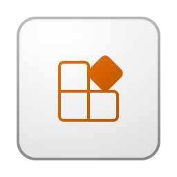 | **Apps** | `icons/fabric/apps.svg` |
| 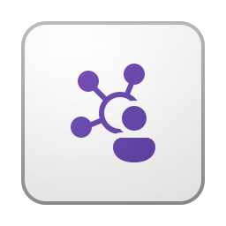 | **Cohort** | `icons/fabric/cohort.svg` |
| 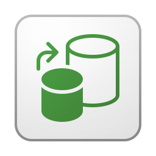 | **Copy Job** | `icons/fabric/copy-job.svg` |
| 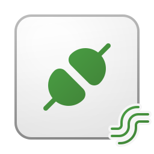 | **Custom Streaming Connector** | `icons/fabric/custom-streaming-connector.svg` |
|  | **Dashboard** | `icons/fabric/dashboard.svg` |
| 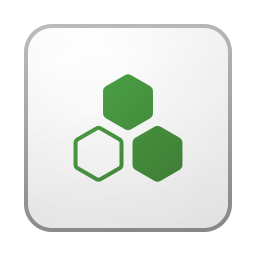 | **Data Agent** | `icons/fabric/data-agent.svg` |
|  | **Data Factory** | `icons/fabric/data-factory.svg` |
| 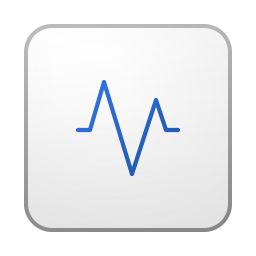 | **Data Quality** | `icons/fabric/data-quality.svg` |
| 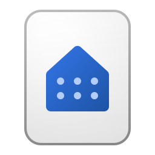 | **Warehouse** | `icons/fabric/data-warehouse.svg` |
| 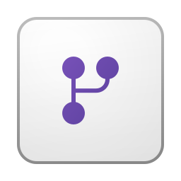 | **Dataflow** | `icons/fabric/dataflow.svg` |
| 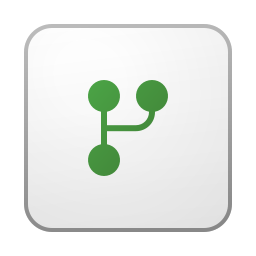 | **Dataflow Gen2** | `icons/fabric/dataflow-gen2.svg` |
| 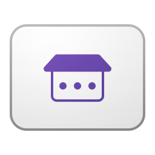 | **Datamart** | `icons/fabric/datamart.svg` |
|  | **Environment** | `icons/fabric/environment.svg` |
| 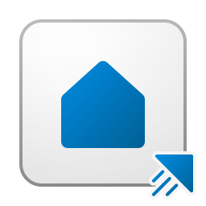 | **Eventhouse** | `icons/fabric/event-house.svg` |
| 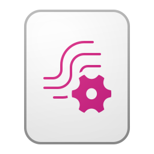 | **Eventstream** | `icons/fabric/eventstream.svg` |
| 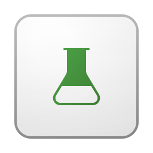 | **ML Experiment** | `icons/fabric/experiments.svg` |
|  | **Exploration** | `icons/fabric/exploration.svg` |
| 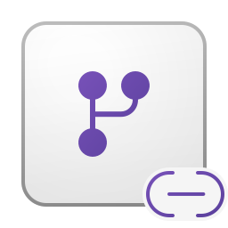 | **External Dataflow** | `icons/fabric/external-dataflow.svg` |
| 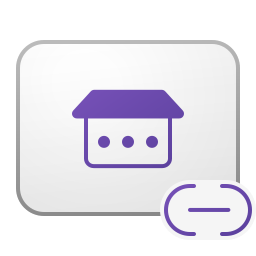 | **External Datamart** | `icons/fabric/external-datamart.svg` |
|  | **External Semantic Model** | `icons/fabric/external-semantic-model.svg` |
| 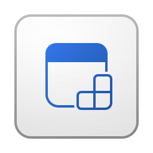 | **Fabric Apps** | `icons/fabric/fabric-apps.svg` |
| 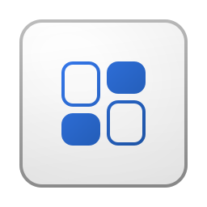 | **Feature Store** | `icons/fabric/feature-store.svg` |
| 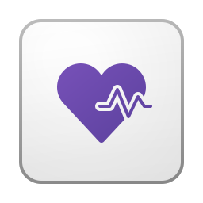 | **Healthcare Data Solutions** | `icons/fabric/healthcare.svg` |
| 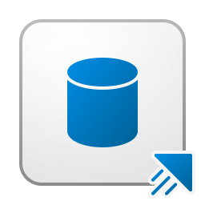 | **KQL Database** | `icons/fabric/kql-database.svg` |
|  | **KQL Queryset** | `icons/fabric/kql-queryset.svg` |
|  | **KQL Script** | `icons/fabric/kql-script.svg` |
| 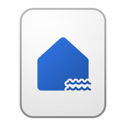 | **Lakehouse** | `icons/fabric/lakehouse.svg` |
|  | **Links** | `icons/fabric/links.svg` |
|  | **Metric Set** | `icons/fabric/metric-sets.svg` |
| 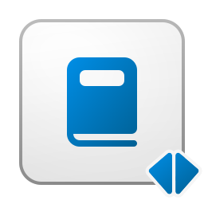 | **Mirrored Catalog** | `icons/fabric/mirrored-catalog.svg` |
| 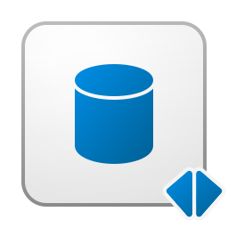 | **Mirrored Database** | `icons/fabric/mirrored-generic-database.svg` |
|  | **Mirrored Storage** | `icons/fabric/mirrored-generic-storage.svg` |
|  | **Mobile Report** | `icons/fabric/mobile-report.svg` |
| 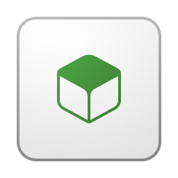 | **ML Model** | `icons/fabric/model.svg` |
|  | **Notebook** | `icons/fabric/notebook.svg` |
|  | **Ontology** | `icons/fabric/ontology.svg` |
| 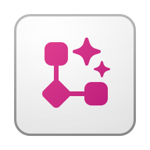 | **Operations Agent** | `icons/fabric/operations-agent.svg` |
|  | **Paginated Report** | `icons/fabric/paginated-report.svg` |
| 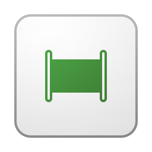 | **Pipeline** | `icons/fabric/pipeline.svg` |
|  | **Planning** | `icons/fabric/planning.svg` |
| 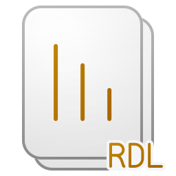 | **RDL Report** | `icons/fabric/rdl-report.svg` |
|  | **Real-Time Dashboard** | `icons/fabric/real-time-dashboard.svg` |
| 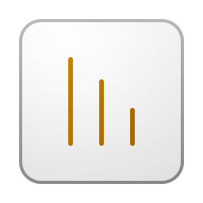 | **Report** | `icons/fabric/report.svg` |
| 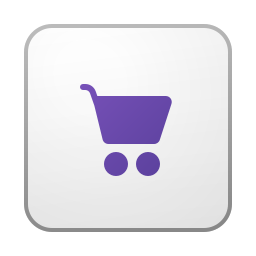 | **Retail Data Solutions** | `icons/fabric/retail.svg` |
| 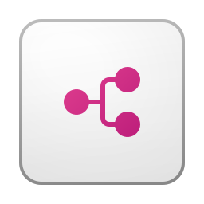 | **Runtime Lineage** | `icons/fabric/runtime-lineage.svg` |
| 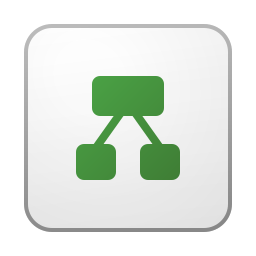 | **Schema Model** | `icons/fabric/schema-model.svg` |
|  | **Scorecard** | `icons/fabric/scorecard.svg` |
|  | **Semantic Model** | `icons/fabric/semantic-model.svg` |
|  | **Shared Semantic Model** | `icons/fabric/shared-semantic-model.svg` |
| 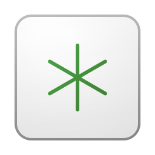 | **Spark Job Definition** | `icons/fabric/spark-job-direction.svg` |
| 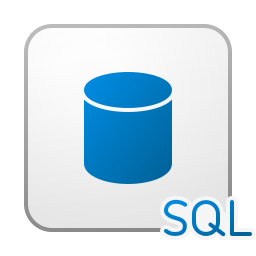 | **SQL Database** | `icons/fabric/sql-database.svg` |
| 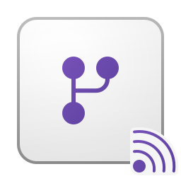 | **Streaming Dataflow** | `icons/fabric/streaming-dataflow.svg` |
|  | **Streaming Semantic Model** | `icons/fabric/streaming-semantic-model.svg` |
| 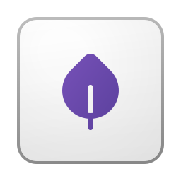 | **Sustainability Data Solutions** | `icons/fabric/sustainability.svg` |
| 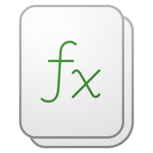 | **User Data Functions** | `icons/fabric/user-data-functions.svg` |
| 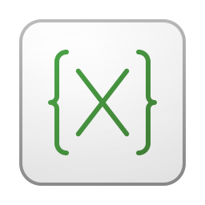 | **Variable Library** | `icons/fabric/variable-library.svg` |

### Other

| Icon | Product | File |
|------|---------|------|
|  | **Admin Center** | `icons/other/admin.svg` |
|  | **Bing** | `icons/other/bing.svg` |
|  | **Designer** | `icons/other/designer.svg` |
|  | **Family Safety** | `icons/other/family-safety.svg` |
|  | **Microsoft Edge** | `icons/other/edge.svg` |
|  | **Microsoft Foundry** | `icons/other/foundry.svg` |
|  | **Office** | `icons/other/office.svg` |

---

## Adding New Icons

When adding a new product icon:

1. **SVG format** — save as `.svg` in the appropriate `icons/{category}/` folder
2. **Naming** — use kebab-case: `product-name.svg` (e.g. `power-apps.svg`)
3. **SVG size** — set `width="256" height="256"` on the `<svg>` tag, preserving the original `viewBox`
4. **PNG version** — create a 512x512 PNG with transparent background alongside the SVG
5. **Update index.html** — add an entry to the relevant category in the `CATEGORIES` array
6. **Description** — use [Microsoft Learn](https://learn.microsoft.com) as the source for product descriptions

## Trademark Notice

All logos and icons are the property of **Microsoft Corporation**.
See [Microsoft Trademark & Brand Guidelines](https://www.microsoft.com/en-us/legal/intellectualproperty/trademarks) before using.
